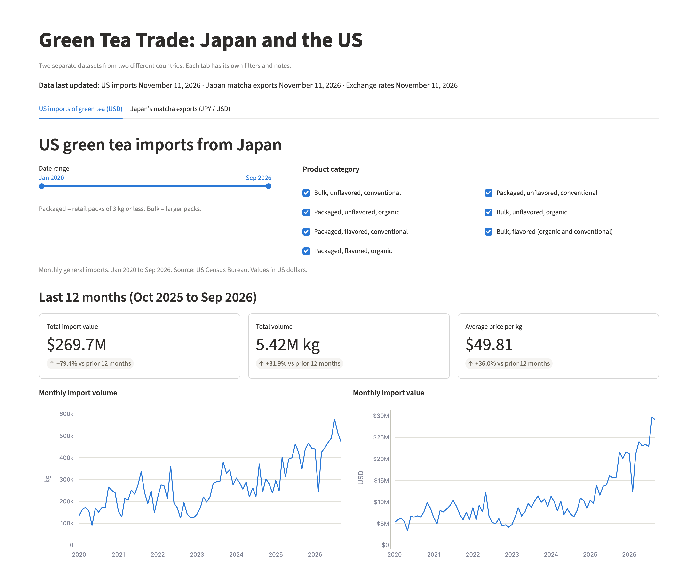
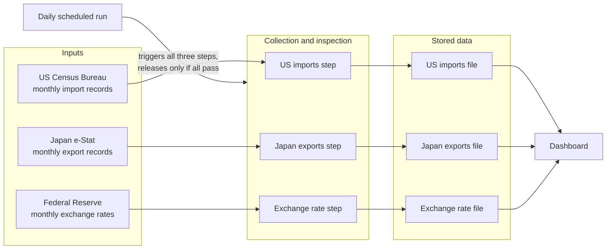

# Green Tea Trade: Japan and the US

A dashboard that measures the flow of green tea and matcha from Japan to the United States, using official trade data from both countries.

**Live demo:** https://tea-import-tracker.streamlit.app/

**Data as of:** September 2026 (latest month published by both countries). **README last updated:** November 11, 2026. The dashboard refreshes daily. The figures in this README are a snapshot and do not.



## Why I built this

Most of what gets written about matcha supply is anecdotal, stories of shortages and price jumps. I wanted to measure it instead. Three questions drove the project: how much matcha is moving from Japan to the US, what it costs per kg, and how much of the cost change comes from the exchange rate.

The answers are in official trade data, but spread across two countries, two languages and two currencies. So I built a process that collects the figures from the source, inspects them and updates itself, and a dashboard that puts them in one place.

## Key findings

All figures are calculated from the data files in this repo, through September 2026.

1. **US green tea imports from Japan more than doubled between 2020 and 2025.** Import value went from $78.9 million in 2020 to $183.8 million in 2025, up 133.0%. Volume went from 2.14 million kg to 4.63 million kg, up 116.9%. *(Calendar years 2020 and 2025, US Census data.)*

2. **Unit cost has jumped in the last year.** From 2020 to 2024 the average import price drifted down, from $36.94 to $32.60 per kg. In the 12 months from October 2025 to September 2026 it reached $49.81 per kg, up 36.0% from $36.62 in the 12 months before. Over the same period import value rose 79.4% and volume rose 31.9%. Price was the larger driver of the increase in spend. *(October 2024 to September 2026, US Census data.)*

3. **Japan's powdered green tea exports to the US grew 3.8 times between 2019 and 2025.** Volume went from 983,187 kg in 2019 to 3,750,730 kg in 2025. 2025 alone was up 69.2% on 2024. *(Calendar years 2019, 2024 and 2025, Japan e-Stat data. 2019 and 2024 are final figures. 2025 figures are at Japan's second revision stage and can still change slightly.)*

4. **The weak yen masked rising matcha prices until recently.** From 2019 to 2024, Japan's export price for powdered green tea rose from ¥4,683 to ¥5,823 per kg, up 24.4%. Over the same years the yen weakened from an average of 109.03 to 151.46 per dollar. In dollars, the price fell 10.4%, from $42.94 to $38.48 per kg. That changed in 2026. For January to September 2026 the yen price was ¥10,044 per kg, up 62.3% on the same months of 2025. In dollars it was about $63.29 per kg, up 50.9%. *(2019 to September 2026, Japan e-Stat data with Federal Reserve exchange rates. Dollar figures are estimates. 2026 figures are not final yet.)*

### What the findings say together

- **Demand is sustained, not a spike.** US-bound powdered green tea volume grew 3.8 times from 2019 to 2025, with only two down years (2022 and 2024). January to September 2026 is 14.7% ahead of the same months of 2025.
- **Cost pressure is real and recent.** Japan's yen price per kg is up 62.3% year on year for January to September 2026. US import prices per kg are up 36.0% over the last 12 months.
- **The currency cushion is gone.** From 2019 to 2024, the weak yen absorbed Japan's price increases for anyone buying in dollars. In 2026 the dollar price rose 50.9%. Buyers paying in dollars now see the full increase.

## Why two data sources

The first measurement point was US import data from the Census Bureau. It has a resolution problem. The US product codes for green tea split it by pack size, flavoring and organic status, but not by whether the tea is powdered. So the US data can measure the green tea trend, but it cannot isolate matcha.

Japan's export data can. In 2019 Japan created dedicated codes for powdered green tea: one for packs of 3 kg or less (0902.10-100) and one for larger packs (0902.20-100). I added Japan's exports to the US from e-Stat, Japan's official statistics portal, as a second measurement point. The dashboard keeps the two datasets on separate tabs. They are measured at different points in the supply chain and should not be combined.

## How it works



The process has four stages:

- **Inputs.** Three official sources, each published monthly: US import records, Japan export records, and yen to dollar exchange rates.
- **Collection and inspection.** One script per source pulls the data and inspects it before anything is stored. A batch that fails inspection is rejected and the last good file stays in place.
- **Storage.** Each source has one data file in the `data/` folder. This is the single source of truth for the dashboard.
- **Output.** The dashboard reads only the stored files. It has no live connection to any source, so a source outage does not take it down.

A scheduled run starts the whole process once a day. If the inspected data has changed, the run saves the new files to the repo. Matcha values are reported in yen. The dashboard can also show them in US dollars, converting each month at that month's average exchange rate.

The matcha view also flags the highest and lowest month for price per kg, and lists each year's price range. These are monthly averages, not single shipment prices, because Japan publishes only monthly totals.

## Data quality checks

- **Reconciled against official annual totals.** I reconciled the monthly matcha figures with e-Stat's published annual totals. For every year from 2019 to 2025, and for January to September 2026, the monthly kg and yen figures for both pack types sum exactly to the official totals. This was a one-time check on November 11, 2026. It is not yet part of the automated process.
- **Incomplete batches are rejected.** Each collection step stops before saving if the batch is empty or is missing any month the stored file already has. The exchange rate step also rejects rates outside a plausible range, and holds the current month until it is complete, so a partial-month average is never used.
- **All three sources release together or not at all.** If any step in the daily run fails, the run stops before saving. The dashboard never shows one fresh dataset next to a stale or broken one.
- **Revision stages are labeled.** Japan publishes each month's figures and then revises them twice before they are final. The process determines each month's stage from Japan Customs' release calendar and cross-checks it against what e-Stat has actually published. If the two disagree, the month gets the less final label. The dashboard shades months that are not final yet.

## Limitations

- **Powdered green tea is a proxy for matcha.** It is the closest official measure, but it can include powdered teas that are not strictly matcha.
- **The data does not measure quality.** The trade codes classify powdered green tea by pack size only. They say nothing about grade (such as ceremonial or culinary), harvest, growing region or farm. Every price per kg is an average across all grades shipped that month. So a price change can come from a shift in the product mix, such as more high grade tea, and not only from higher prices for the same product.
- **The two countries' figures will not reconcile.** They are recorded at different points (leaving Japan vs arriving in the US), valued differently, and in different currencies. The US codes also cover all green tea, not just powdered.
- **USD values for matcha are estimates.** Each month's yen value is converted at that month's average rate. Actual shipments were priced and paid on different days, at different rates.
- **The source cycle is monthly.** The process runs daily, but both countries publish trade data once a month, roughly one to two months after the month ends. Most daily runs find no change.

## Run it yourself

You need Python 3.10 or newer (the daily run uses 3.13).

1. Copy the repo and install the requirements:

   ```bash
   git clone https://github.com/jpacheco-dev/tea-import-tracker.git
   cd tea-import-tracker
   python -m venv .venv
   source .venv/bin/activate
   pip install -r requirements.txt
   ```

2. Start the dashboard. The data files are already in the repo, so this works without any keys:

   ```bash
   streamlit run app.py
   ```

3. To pull fresh data yourself, get two free access keys:

   - **US Census key:** sign up at https://api.census.gov/data/key_signup.html. The key arrives by email.
   - **Japan e-Stat app ID:** register at https://www.e-stat.go.jp/api/, log in, and issue an application ID from your account page.

   The exchange rates come from a public download and need no key.

4. Create a file named `.env` in the project folder with your keys:

   ```
   CENSUS_API_KEY=your_census_key
   ESTAT_APP_ID=your_estat_app_id
   ```

   The scripts read this file at startup. It is excluded from the repo, so your keys are never shared. The scripts also never print request addresses, because the keys are part of them.

5. Run the three collection steps:

   ```bash
   python src/fetch_data.py
   python src/fetch_japan_data.py
   python src/fetch_fx_data.py
   ```

To run the daily process on your own copy, add `CENSUS_API_KEY` and `ESTAT_APP_ID` as repository secrets under Settings > Secrets and variables > Actions. The schedule is defined in `.github/workflows/refresh-data.yml`. You can also start a run by hand from the Actions tab.

## Built with AI

I built this project with Claude Code, Anthropic's AI coding tool. The commit history shows five build stages over two days: US data collection, the dashboard, Japan data collection, the matcha view, and then USD pricing with the daily scheduled run.

**What I directed**

- The research questions: how are US-bound volume and unit cost for Japanese matcha changing, and how much of the cost change is currency?
- The measurement points, and the decision to add Japan's export data once the US codes proved too coarse to isolate matcha.
- The process requirements: never replace good data with a bad batch, label figures that are not final, and mark USD values as estimates.
- The plain language labels and notes on the dashboard, written for someone who does not work with trade data.

**What I verified**

- The monthly matcha figures against e-Stat's official annual totals, for 2019 to September 2026.
- That the US product-level figures sum to the totals for each green tea category.
- The country codes, product codes and units against each source's own documentation.
- The dashboard's headline numbers against calculations from the raw data files.

**What I would improve next**

- Build the annual totals reconciliation into the daily run, so it is a standing control and not a one-time check.
- Add automated tests. There are none yet.
- Lock package versions, so an outside software update cannot stop the daily run.
- Consolidate the batch rejection check, which is repeated in all three scripts, into one shared component.
- Add a template `.env` file to make setup more standard.
- Add other source countries, such as China, to measure Japan's share of US green tea imports.

## Tech stack

- **Python** with pandas and requests for collecting and cleaning the data
- **Streamlit** and **Plotly** for the dashboard
- **GitHub Actions** for the daily scheduled run
- **Streamlit Community Cloud** for hosting
- Data from the **US Census Bureau**, **Japan's e-Stat**, and the **Federal Reserve** (G.5 exchange rates, via FRED)

## License

MIT. See [LICENSE](LICENSE).
